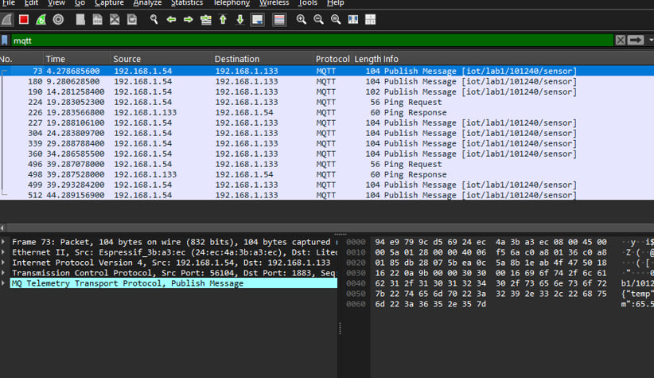
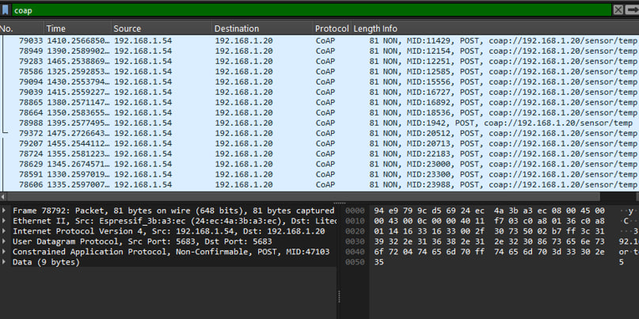

<div align="center">
  <h1>📡 Truyền thông IoT</h1>
  <h3>Bộ bài thực hành Arduino · ESP32 · Các giao thức IoT</h3>
  <p><strong>Bùi Cao Nguyên · MSSV: 10124238</strong></p>
  <p>
    
    
    
    
    
  </p>
</div>

> Kho lưu trữ mã nguồn, mô phỏng Proteus và hình ảnh kết quả của các bài thực hành môn **Truyền thông IoT**.

## 🧭 Danh sách bài thực hành

| Bài | Chủ đề | Nội dung chính | Tài nguyên |
|:---:|---|---|:---:|
| **B2** | Giao tiếp UART | Truyền lệnh giữa hai Arduino, điều khiển LED và thay đổi baud rate | [Mở B2](./B2) |
| **B3** | Đồng hồ báo thức | Arduino Uno, RTC DS1307, LCD I²C, EEPROM và ngắt nút nhấn | [Mở B3](./B3) |
| **B4** | Kết quả thực hành | Hình ảnh ghi nhận kết quả của bài | [Mở B4](./B4) |
| **B5** | Bluetooth & BLE | Mô phỏng HC-05, giao tiếp UART và BLE Server điều khiển RGB LED | [Mở B5](./B5) |
| **B8** | ESPHome | ESP32-S3, Web Server và hiệu ứng LED RGB WS2812 | [Mở B8](./B8) |
| **B10** | Kết quả thực hành | Hình ảnh ghi nhận kết quả của bài | [Mở B10](./B10) |
| **B12** | MQTT | ESP32 gửi dữ liệu nhiệt độ/độ ẩm dạng JSON đến Mosquitto Broker | [Mở B12](./B12) |
| **B13** | CoAP | So sánh CON/NON, ACK và retransmission bằng ESP32, Node.js, Wireshark | [Mở B13](./B13) |

## 🧰 Công nghệ sử dụng

- **Phần cứng:** Arduino Uno, ESP32-S3, RTC DS1307, LCD I²C, HC-05, WS2812.
- **Giao thức:** UART, Bluetooth Classic, BLE, MQTT và CoAP.
- **Công cụ:** Arduino IDE, Proteus, ESPHome, Node.js, Mosquitto và Wireshark.
- **Ngôn ngữ:** C/C++ (Arduino), JavaScript và YAML.

## 🖼️ Một số kết quả

<table>
  <tr>
    <td width="33%" align="center">
      
      <br /><sub><b>UART giữa hai Arduino</b></sub>
    </td>
    <td width="33%" align="center">
      
      <br /><sub><b>Phân tích gói tin MQTT</b></sub>
    </td>
    <td width="33%" align="center">
      
      <br /><sub><b>Phân tích gói tin CoAP</b></sub>
    </td>
  </tr>
</table>

## 🚀 Bắt đầu nhanh

### Arduino và Proteus

1. Mở file `.ino` bằng Arduino IDE và chọn đúng loại board.
2. Biên dịch chương trình để tạo file `.hex` khi chạy mô phỏng.
3. Mở file `.pdsprj` bằng Proteus, gán file chương trình cho vi điều khiển rồi chạy mô phỏng.

### ESPHome — B8

Điền lại thông tin Wi-Fi trong [`B8/Code/esp.txt`](./B8/Code/esp.txt), sau đó biên dịch và nạp cấu hình bằng ESPHome.

### MQTT — B12

Điền Wi-Fi, địa chỉ Mosquitto Broker và tài khoản MQTT trong [`sketch_oct10a.ino`](./B12/sketch_oct10a/sketch_oct10a.ino) trước khi nạp cho ESP32.

### CoAP — B13

```bash
cd B13
npm install
npm start
```

Sau đó cấu hình Wi-Fi và địa chỉ IP của máy chạy Node.js trong [`sketch_oct15a.ino`](./B13/B13ARDUINO/sketch_oct15a/sketch_oct15a.ino).

## 🗂️ Cấu trúc repository

```text
TruyenthongIOT/
├── B2/              # UART và mô phỏng Proteus
├── B3/              # Đồng hồ báo thức RTC
├── B4/              # Hình ảnh kết quả
├── B5/              # Bluetooth Classic và BLE
├── B8/              # ESPHome + RGB LED
├── B10/             # Hình ảnh kết quả
├── B12/             # MQTT Publisher
└── B13/             # CoAP Client/Server
```

> [!IMPORTANT]
> Thông tin Wi-Fi và MQTT trong mã nguồn được thay bằng giá trị mẫu. Không đưa mật khẩu thật lên repository công khai.

---

<div align="center">
  <sub>Thực hiện cho học phần Truyền thông IoT · 2026</sub>
</div>

